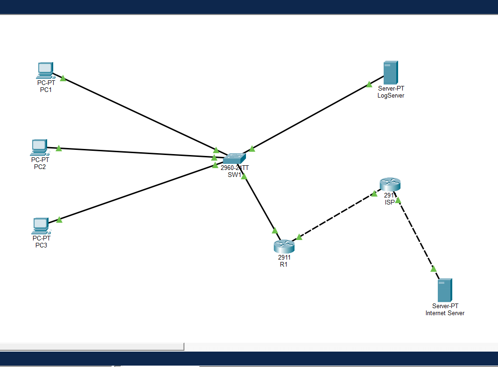

# Small Company Network Lab (Cisco Packet Tracer)

A simulated small-office network built in Cisco Packet Tracer. It combines VLAN segmentation, inter-VLAN routing, DHCP, NAT, an access control list, port security and centralised logging, followed by three troubleshooting exercises where faults were introduced and diagnosed from evidence.

> **Scope:** this is a simulation in Cisco Packet Tracer, not production equipment. Some behaviour differs from real devices, and I note one such difference below.

**Author:** Anji Gajula · cybersecurity graduate (B.Tech) · [LinkedIn](#) <!-- www.linkedin.com/in/anji-gajula-6b8712292 -->

---

## Why I built it

SOC analysts read alerts and logs that come from networks. To judge an alert, you need to know how the network normally behaves. I built this lab to understand that from the ground up, and to practise the habit that matters most in an investigation: form a hypothesis, find the evidence, then fix.

## Topology



```
SALES  PC1, PC2 --\
HR     PC3 ---------- SW1 ==trunk== R1 ==== ISP ---- Internet server
SERVERS LogServer -/   (VLANs 10/20/30)   (NAT)
```

| Device | Role |
|---|---|
| SW1 (2960) | Switch with VLANs, trunk to R1, port security on PC ports |
| R1 (2911) | Router-on-a-stick gateway, DHCP server, NAT, ACL |
| ISP (2911) | Stands in for the internet provider |
| Internet server | A destination outside the company |
| LogServer | Receives syslog messages from SW1 and R1 |

## Addressing plan

| Network | Subnet | Gateway | Assigned by |
|---|---|---|---|
| VLAN 10 SALES | `192.168.10.0/24` | `192.168.10.1` | DHCP |
| VLAN 20 HR | `192.168.20.0/24` | `192.168.20.1` | DHCP |
| VLAN 30 SERVERS | `192.168.30.0/24` | `192.168.30.1` | Static |
| R1 to ISP | `203.0.113.0/30` | R1 `.2`, ISP `.1` | Static |
| Internet | `198.51.100.0/24` | ISP `.1` | Static |

## What it demonstrates

| Skill | Where |
|---|---|
| VLANs and 802.1Q trunking | SW1 |
| Inter-VLAN routing (router-on-a-stick) | R1 subinterfaces |
| DHCP with excluded ranges, one pool per VLAN | R1 |
| NAT with overload (PAT) | R1 |
| Extended ACL (Sales may not reach HR) | R1, inbound on the Sales subinterface |
| Port security with sticky MAC and shutdown | SW1 PC ports |
| Centralised logging with timestamps (syslog) | SW1 and R1 to LogServer |
| Systematic troubleshooting | See below |

## Verification

| Test | Expected result |
|---|---|
| `show vlan brief` on SW1 | VLANs 10, 20, 30 with the correct ports |
| `show interfaces trunk` on SW1 | Gi0/1 trunking, VLANs 10, 20, 30 allowed |
| PCs request DHCP | Sales gets `192.168.10.x`, HR gets `192.168.20.x`, correct gateways |
| PC1 pings PC2 (same VLAN) | Succeeds |
| PC1 pings PC3 (Sales to HR) | Blocked by the ACL |
| PC1 pings LogServer | Succeeds |
| PC1 and PC3 ping Internet server | Succeed |
| `show ip nat translations` on R1 | Entries for both `192.168.10.x` and `192.168.20.x` |
| `show access-lists` on R1 | Deny rule shows matches after a Sales to HR ping |
| `show port-security interface fa0/2` on SW1 | `Secure-up`, one sticky MAC |
| LogServer syslog page | Messages from SW1 and R1 |

Screenshots of these outputs are in [`verification/`](verification/): VLANs, the trunk, routing with NAT and the ACL, and port security.

**Design note:** an ACL checks each packet on its own and does not track conversations. Because the Sales to HR rule is applied inbound on the Sales subinterface, it also drops Sales' replies to a ping that HR starts. A stateful firewall would allow those replies.

## Troubleshooting exercises

Full write-ups, with the actual command output, are in [`troubleshooting/troubleshooting.md`](troubleshooting/troubleshooting.md). Each follows the same format: symptom, hypothesis, evidence, fix.

| # | Symptom | Cause | Key evidence |
|---|---|---|---|
| Issue 1 | Internet server unreachable | ISP's address entered on R1's `Gi0/0` | `show ip route` listed the Internet network as connected to the wrong interface |
| Fault 1 | Sales cannot reach the internet, HR can | Sales missing from the NAT access list | NAT table had no `192.168.10.x` entries, and ACL 1 listed only HR |
| Fault 2 | HR loses all connectivity | VLAN 20 removed from the trunk's allowed list | `show interfaces trunk` allowed only VLANs 10 and 30 |
| Fault 3 | PC2 loses its port after a laptop is plugged in | Port security shut the port down | `err-disabled`, violation count 1, and the same MAC in the switch output, the syslog and the laptop |

Fault 1 also recurred once because the fix had not been saved with `write memory`, which is a reminder that running-config changes are lost on restart.

## Security angle: reading the alert

When the unknown laptop was connected, the switch sent this to the log server:

```
%PORT_SECURITY-2-PSECURE_VIOLATION: Security violation occurred, caused by MAC address 00E0.A3A5.7EB7 on port FastEthernet0/2.
```

Reading it as an analyst: severity 2 (critical), the port (`FastEthernet0/2`), and the offending MAC, which matched the laptop's Physical Address and the switch's own `Last Source Address`. Three independent sources agreeing is what turns a guess into a finding. The log shows what and where, but not why. Finding out whether it was a harmless desk swap or an intruder needs other evidence.

## Repository contents

```
README.md
topology/         topology.png, lab11-final.pkt
configs/          SW1, R1 and ISP configuration and running-config output
verification/     screenshots of key show commands
troubleshooting/  troubleshooting.md
```

## How to run it

1. Install Cisco Packet Tracer (free with a Cisco Networking Academy account).
2. Open `topology/lab11-final.pkt`.
3. Compare each device with the files in `configs/`.

## What I learned

- A fault is easiest to find by checking one hop at a time and stopping at the first thing that fails.
- NAT and ACLs interact: an outbound ACL sees the address after NAT has changed it, so placement matters.
- Port security does nothing until the unknown device actually sends traffic.
- Always save: changes live in RAM until `write memory`.
